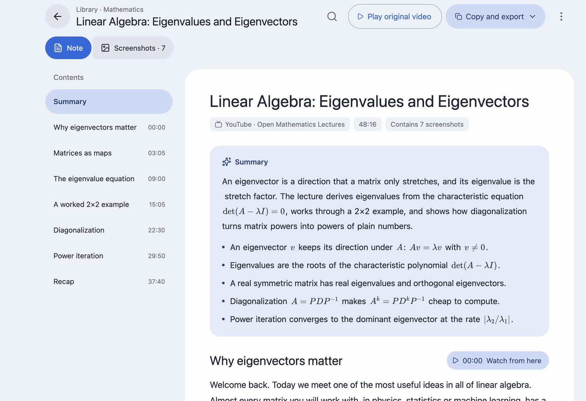
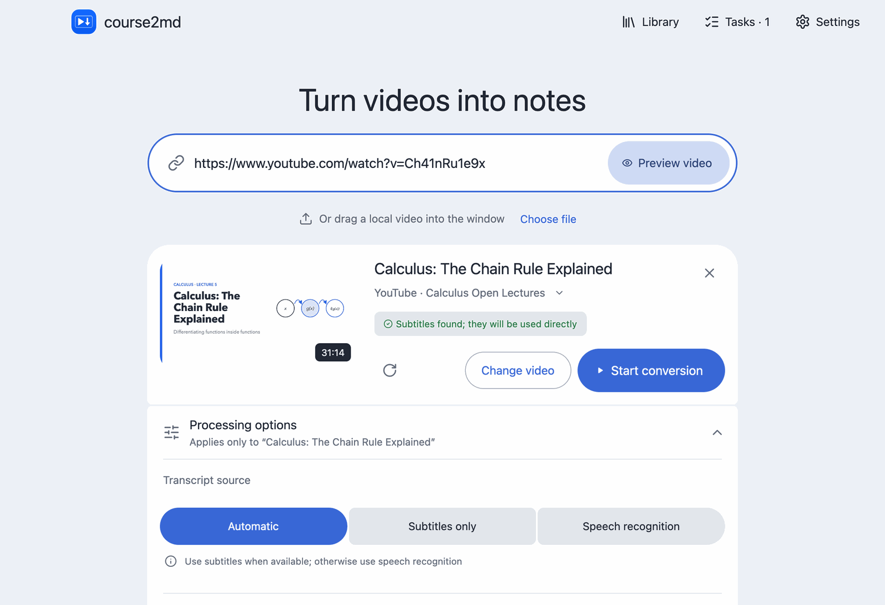
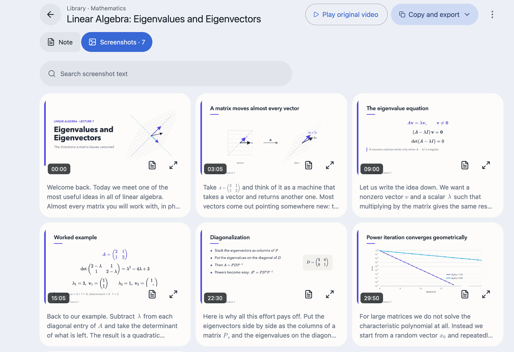
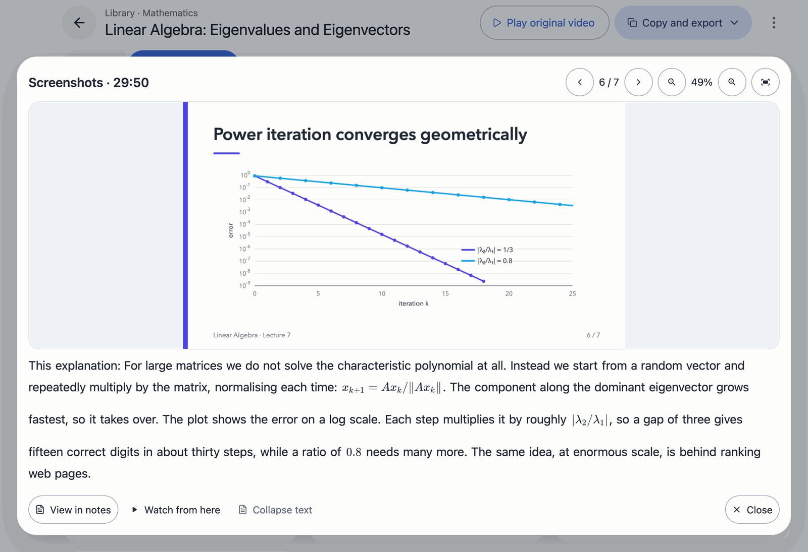
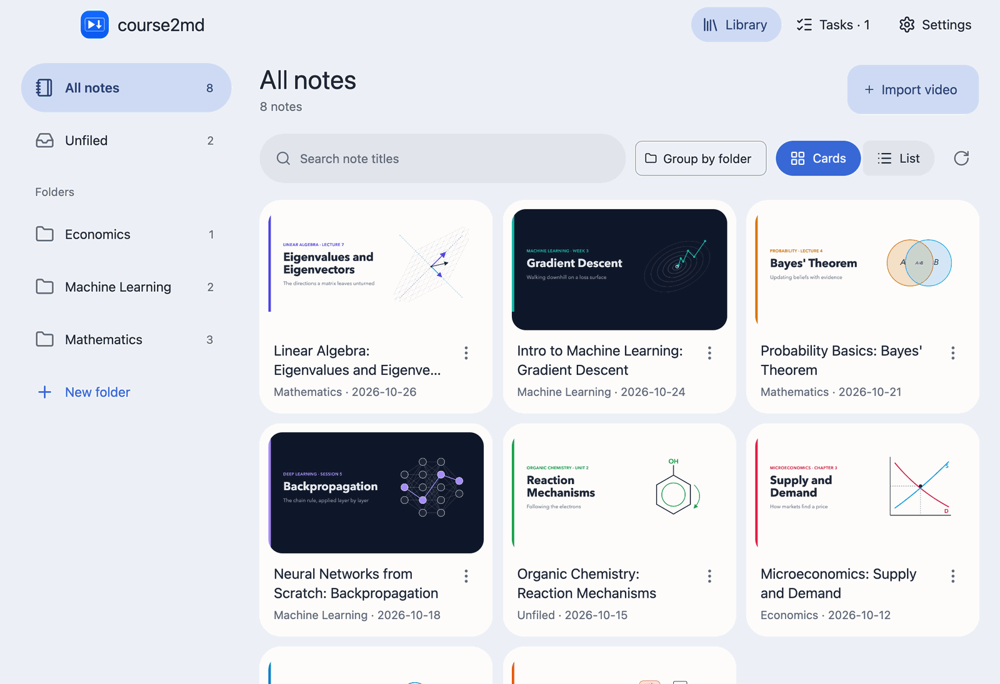
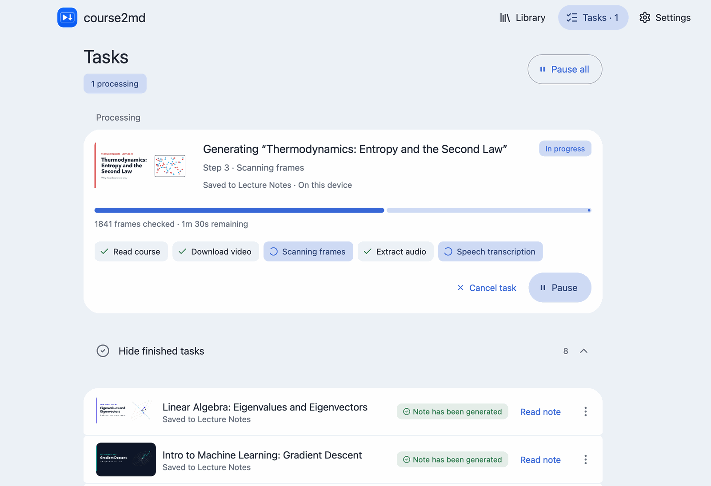
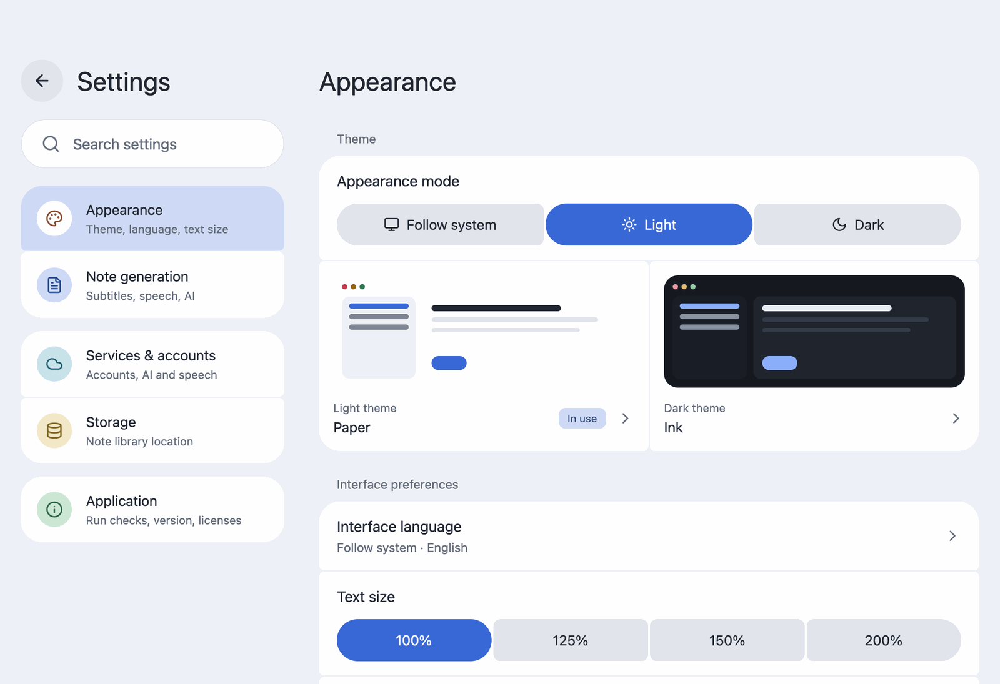

<div align="center">


# course2md

**Turn lecture videos into illustrated notes you can read, search and keep.**

Paste a YouTube or Bilibili link, or drop in a local video. course2md captures a screenshot every time the slide changes, transcribes what is said beneath it, and keeps the result in a library on your computer.

[](https://github.com/mizorewww/course2md/releases/latest)
[](LICENSE)


**English** · [中文](readme.zh.md) · [Download](#install) · [Wiki](https://github.com/mizorewww/course2md/wiki)

</div>

<picture>
  <source media="(prefers-color-scheme: dark)" srcset="docs/images/en/reader-dark.png">
  
</picture>

## Why course2md

- **Notes shaped like the lecture.** One screenshot per slide, with the matching transcript in paragraphs underneath, saved as an ordinary `course.md` with its screenshots that opens anywhere; export a web page, a .zip or JSON whenever you need one.
- **Private by default.** Speech is recognized on your own computer: Apple Silicon works out of the box, and other systems use a graphics card, the CPU or an Intel Core Ultra NPU. Audio leaves your computer only if you choose a cloud service.
- **Subtitles first.** When a video already has subtitles they are used directly, with no speech recognition needed.
- **Optional AI.** Proofreading, summaries, bilingual notes and typeset math formulas with any OpenAI-compatible service, a local Ollama server or a ChatGPT subscription. Off until you turn it on.
- **Four languages.** English, 简体中文, 繁體中文 and 日本語, following your system language.

## A tour of the app

### Add a video

Paste a link or drag a file onto **Home**, the start page (click the course2md logo to return to it). course2md reads the video first, so you can check the title, length and processing options before anything is converted.

<picture>
  <source media="(prefers-color-scheme: dark)" srcset="docs/images/en/home-dark.png">
  
</picture>

### Read, find and copy

The reader opens on a summary and key points, keeps an outline of the sections beside the note, and finds text across the whole note. Formulas are typeset, and copying a passage gives you the original text with each formula's LaTeX.

### Browse every slide

The **Screenshots** view shows the whole lecture at a glance. Open any slide to see it large, zoom and pan, and read what was said at that moment.

<picture>
  <source media="(prefers-color-scheme: dark)" srcset="docs/images/en/screenshots-dark.png">
  
</picture>

<picture>
  <source media="(prefers-color-scheme: dark)" srcset="docs/images/en/viewer-dark.png">
  
</picture>

### Keep a library

Notes live in a library with nested folders, drag and drop, and search that covers subfolders. You can keep several library locations, and deleted notes go to the Trash (Recycle Bin on Windows and Linux).

<picture>
  <source media="(prefers-color-scheme: dark)" srcset="docs/images/en/library-dark.png">
  
</picture>

### Let it work in the background

Conversions run as tasks you can pause, resume and reorder. Each step shows its progress, and model downloads show their size, speed and time left. If one part fails, read what finished and redo only the rest.

<picture>
  <source media="(prefers-color-scheme: dark)" srcset="docs/images/en/tasks-dark.png">
  
</picture>

### Make it yours

Choose from 10 themes, adjust the text size and reduce motion in **Settings → Appearance**.

<picture>
  <source media="(prefers-color-scheme: dark)" srcset="docs/images/en/settings-dark.png">
  
</picture>

## Install

The desktop app includes the conversion engine and the video tools it runs (`ffmpeg`, `ffprobe` and `yt-dlp`), so the downloads below work without installing anything else. You do not need the command-line tool to use it.

### macOS (Apple Silicon, macOS 15 or later)

With [Homebrew](https://brew.sh), this installs the app together with `yt-dlp` and `aria2` (faster model downloads):

```sh
brew install --cask mizorewww/tap/course2md-gui
```

Then open **course2md** from **Applications**. Without Homebrew, [download the DMG](https://github.com/mizorewww/course2md/releases/latest/download/course2md-gui-macos-arm64.dmg) and drag **course2md** to Applications; see the [macOS guide](https://github.com/mizorewww/course2md/wiki/GUI-Installation#macos-apple-silicon).

### Windows (x64)

1. [Download the portable ZIP](https://github.com/mizorewww/course2md/releases/latest/download/course2md-desktop-windows-AMD64.zip) and **extract everything** to a permanent folder. It includes `ffmpeg`, `yt-dlp`, `aria2`, `uv` (Intel NPU recognition) and `llama-server` for GPU (Vulkan) and CPU recognition. GPU and CPU recognition also need the [Microsoft Visual C++ runtime](https://aka.ms/vs/17/release/vc_redist.x64.exe); if it is missing, **Run checks** says so and links the installer.
2. Open **course2md-desktop.exe** from the extracted folder and keep the other files next to it.

### Arch Linux / CachyOS (x86_64)

```sh
yay -S course2md-gui-bin
```

(or `paru -S course2md-gui-bin`). This installs the app, the system's video tools and the graphics libraries; your GPU needs a working Vulkan driver. See the [Linux guide](https://github.com/mizorewww/course2md/wiki/GUI-Installation#arch-linux--cachyos).

### Ubuntu and other Linux (x86_64)

[Download the tar.gz](https://github.com/mizorewww/course2md/releases/latest/download/course2md-desktop-linux-x86_64.tar.gz), install the graphics libraries from the [Linux guide](https://github.com/mizorewww/course2md/wiki/GUI-Installation#other-linux-x64-distributions), extract it and run `./course2md-desktop`. Built on Ubuntu 24.04; it includes `ffmpeg`, `yt-dlp`, `uv` and `llama-server` (GPU recognition uses your Vulkan driver).

Intel Macs and Linux ARM64 have no desktop app yet; use the [command-line tool](#command-line-tool).

## First steps

1. Open **course2md** and follow the setup: choose how speech is recognized, optionally connect an AI service and Bilibili, and download the speech model (1–2.4 GB, once).
2. If anything is missing, **Settings → Application → Run checks** shows which tool to install.
3. On **Home**, paste a link or drop a video, review the preview and click **Start conversion**. Finished notes appear in **Library**.

Notes go to a default library; add other folders in **Settings → Storage**. The interface follows your system language; change it in **Settings → Appearance → Interface language**. More in the [first-launch guide](https://github.com/mizorewww/course2md/wiki/GUI-Installation#first-launch).

## Questions

**Conversion says `ffmpeg` is missing.** The downloaded app keeps its own `ffmpeg` next to `course2md-desktop`; extract or reinstall the whole package. The CLI and the Arch package use the system's: install it (`brew install ffmpeg` on macOS, `winget install --id Gyan.FFmpeg -e` on Windows, your package manager on Linux). **Settings → Application → Run checks** (CLI: `course2md doctor`) shows where each tool comes from.

**A Bilibili video fails or comes back in low quality.** Log in under **Settings → Services & accounts → Bilibili account** by scanning the QR code.

**How large are the model downloads, and where do they go?** About 1–2.3 GB on Apple Silicon (`~/Library/Caches/qwen3-speech/`) and 2.4 GB elsewhere (`~/.cache/course2md/models/`). In mainland China they download from domestic mirrors (ModelScope / hf-mirror.com); elsewhere these are fallbacks. Downloads resume after interruptions, and GPU/CPU models are checked with SHA-256.

**I upgraded from 1.7. Where are my notes?** Notes made by 1.x stay where they were as `course.md` / `course.html` and still open in any editor or browser, but the 2.0 library only lists notes made by 2.0. Downloaded models, the Bilibili login and the CLI's `config.toml` keep working; set up recognition and AI services again in the setup steps.

More answers in [Troubleshooting](https://github.com/mizorewww/course2md/wiki/Troubleshooting).

## Command-line tool

Prefer the terminal or scripts? The `course2md` CLI does the same conversion. It can be installed beside the desktop app; the two share the Bilibili and ChatGPT logins and the downloaded speech models, and each keeps its own settings.

```sh
curl -fsSL https://raw.githubusercontent.com/mizorewww/course2md/main/install.sh | bash   # macOS / Linux, into ~/bin
brew install mizorewww/tap/course2md                                                      # or Homebrew
yay -S course2md-bin                                                                      # or Arch
```

It needs `ffmpeg`; online links also need `yt-dlp` (installed by the script if missing), and with `aria2` models download over several connections. Local recognition on non-Apple systems needs `llama-server`. Check everything with `course2md doctor`.

```sh
course2md ./lecture.mp4                        # a local file
course2md https://www.youtube.com/watch?v=…    # or a YouTube / Bilibili link
course2md ./lecture.mp4 -o ./notes             # choose where notes go
```

The first run asks a few setup questions; notes are saved as `platform/title/ID/` under the output folder.

| Command | Purpose |
| --- | --- |
| `course2md --login bilibili` / `--logout bilibili` | Log in to Bilibili with a QR code / remove the saved login |
| `course2md --login ollama` / `--login codex` | Use a local Ollama server / a ChatGPT subscription via the Codex login |
| `course2md doctor` | Check tools, speech backends and settings |
| `course2md models list` / `models prepare` | Check downloaded models / download one ahead of time |
| `course2md llm setup` / `llm status` / `llm disable` | Configure, inspect or turn off AI proofreading |
| `course2md summarize ./notes` | Add AI summaries to existing notes |
| `course2md config init` / `config show` | Create a configuration template / show the settings |

CLI settings live in `~/.config/course2md/config.toml` (`%APPDATA%\course2md\config.toml` on Windows), and options override them. `course2md remove` clears the CLI's AI service settings and the ChatGPT login. `--lang en|zh-Hans|zh-Hant|ja` (or `COURSE2MD_LANG`) sets the language; `--json` output stays in Simplified Chinese for scripts. See `<command> --help` and the [CLI guide](https://github.com/mizorewww/course2md/wiki/CLI-Guide).

## Help and contributing

[Documentation (Wiki)](https://github.com/mizorewww/course2md/wiki) · [Upgrade and uninstall](https://github.com/mizorewww/course2md/wiki/GUI-Installation#upgrade-and-uninstall) · [Troubleshooting](https://github.com/mizorewww/course2md/wiki/Troubleshooting) · [Report a problem](https://github.com/mizorewww/course2md/issues) · [Release notes](https://github.com/mizorewww/course2md/releases)

For developers: [contributing](AGENTS.md) · [desktop development](desktop/README.md) · [engine architecture](docs/DESIGN.md) · [benchmarks](docs/BENCHMARKS.md) · [releases](docs/PACKAGING.md) · [Changelog](CHANGELOG.md)

course2md is released under the [MIT license](LICENSE).
