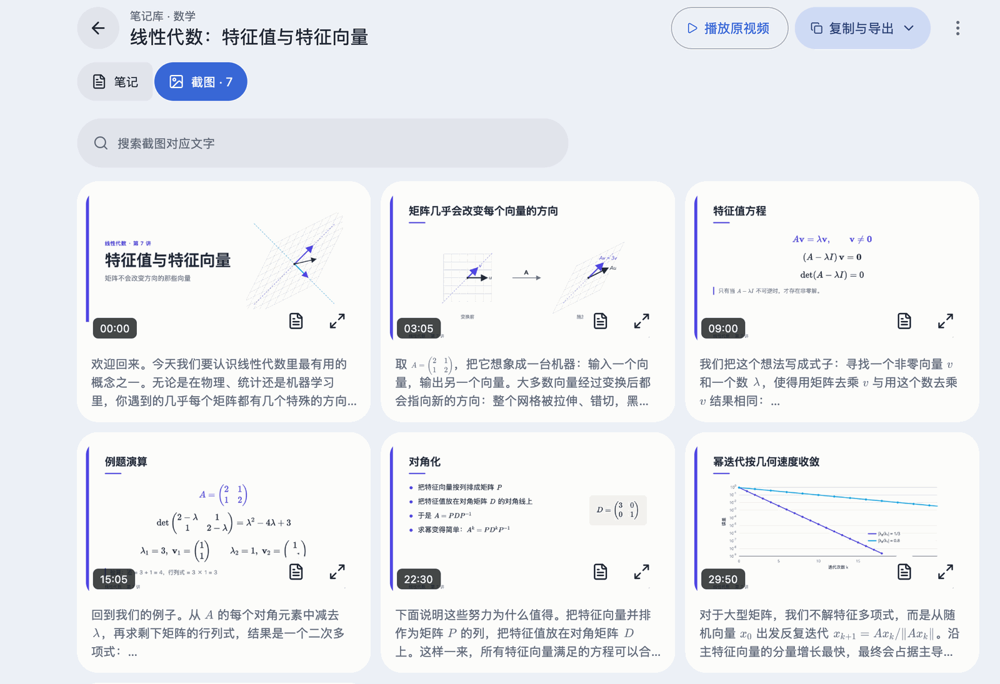
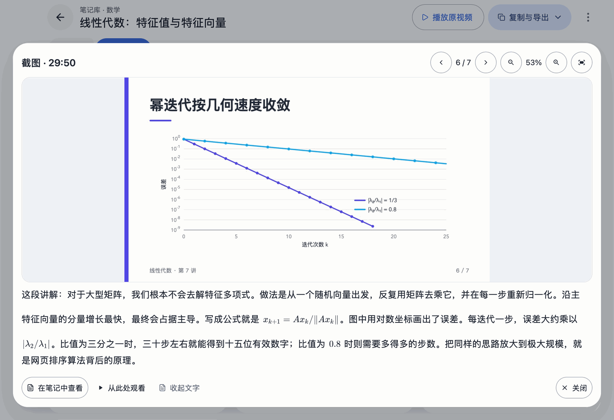

<div align="center">


# course2md

**把课程视频变成图文笔记，随时阅读、查找和保存。**

粘贴 YouTube 或 Bilibili 链接，或拖入本地视频。course2md 在每次换页时截图，把讲解的话整理在截图下方，并保存在你电脑上的笔记库里。

[](https://github.com/mizorewww/course2md/releases/latest)
[](LICENSE)


[English](readme.md) · **中文** · [下载](#安装) · [Wiki](https://github.com/mizorewww/course2md/wiki)

</div>

<picture>
  <source media="(prefers-color-scheme: dark)" srcset="docs/images/zh/reader-dark.png">
  
</picture>

## 为什么用 course2md

- **笔记跟着课件走。**每页幻灯片一张截图，对应的讲解按段落排在下方，保存为普通的 `course.md` 加截图，在哪里都能打开；需要时可以导出网页、.zip 或 JSON。
- **默认在本机处理。**语音识别在你的电脑上完成：Apple 芯片开箱即用，其他系统可用显卡、CPU 或 Intel Core Ultra 的 NPU。只有选择云端服务时音频才会上传。
- **有字幕先用字幕。**视频自带字幕时直接使用，无需语音识别。
- **AI 可选。**校对、摘要、双语笔记和数学公式排版，支持任意 OpenAI 兼容服务、本地 Ollama 或 ChatGPT 订阅，默认关闭。
- **四种界面语言。**English、简体中文、繁體中文和日本語，默认跟随系统。

## 看看应用

### 添加视频

在「主页」（启动后的首页，点左上角的 course2md 标志可返回）粘贴链接或拖入文件。course2md 会先读取视频信息，你可以确认标题、时长和处理选项后再开始转换。

<picture>
  <source media="(prefers-color-scheme: dark)" srcset="docs/images/zh/home-dark.png">
  
</picture>

### 阅读、查找和复制

阅读器以摘要和要点开头，旁边是章节目录，可在整篇笔记中查找文字。公式会排版显示，复制一段文字时得到原文，公式保留原始 LaTeX。

### 浏览每一页截图

「截图」视图一眼看完整节课。点开任意一页可放大、缩放和拖动，并阅读这页讲了什么。

<picture>
  <source media="(prefers-color-scheme: dark)" srcset="docs/images/zh/screenshots-dark.png">
  
</picture>

<picture>
  <source media="(prefers-color-scheme: dark)" srcset="docs/images/zh/viewer-dark.png">
  
</picture>

### 整理笔记库

笔记库支持嵌套文件夹、拖放整理和包含子文件夹的搜索，可以同时使用多个保存位置；删除的笔记移到废纸篓（Windows 和 Linux 为回收站）。

<picture>
  <source media="(prefers-color-scheme: dark)" srcset="docs/images/zh/library-dark.png">
  
</picture>

### 在后台处理

转换作为任务在后台运行，可以暂停、继续和调整顺序。每一步都显示进度，模型下载显示大小、速度和剩余时间。某一部分失败时，可以先阅读已完成的内容，只补做失败的部分。

<picture>
  <source media="(prefers-color-scheme: dark)" srcset="docs/images/zh/tasks-dark.png">
  
</picture>

### 按自己的习惯设置

在「设置 → 外观」选择 10 套主题之一，调整界面文字大小，或减少动态效果。

<picture>
  <source media="(prefers-color-scheme: dark)" srcset="docs/images/zh/settings-dark.png">
  
</picture>

## 安装

桌面应用自带转换引擎和它用到的视频工具（`ffmpeg`、`ffprobe` 和 `yt-dlp`），下载下面的安装包即可使用，无需另装其他程序，也不需要命令行工具。

### macOS（Apple 芯片，macOS 15 及以上）

使用 [Homebrew](https://brew.sh) 时，这条命令会安装应用以及 `yt-dlp` 和 `aria2`（加快模型下载）：

```sh
brew install --cask mizorewww/tap/course2md-gui
```

然后从「应用程序」打开 **course2md**。不使用 Homebrew 时，[下载 DMG](https://github.com/mizorewww/course2md/releases/latest/download/course2md-gui-macos-arm64.dmg)，把 **course2md** 拖入「应用程序」即可，详见 [macOS 指南](https://github.com/mizorewww/course2md/wiki/%E5%AE%89%E8%A3%85%E6%A1%8C%E9%9D%A2%E5%BA%94%E7%94%A8#macos-apple-silicon)。

### Windows（x64）

1. [下载便携包（ZIP）](https://github.com/mizorewww/course2md/releases/latest/download/course2md-desktop-windows-AMD64.zip)，**完整解压**到固定文件夹。包内已有 `ffmpeg`、`yt-dlp`、`aria2`、`uv`（Intel NPU 识别）和用于显卡（Vulkan）与 CPU 识别的 `llama-server`。
2. 打开解压目录中的 **course2md-desktop.exe**，其他文件保持在同一目录。

### Arch Linux / CachyOS（x86_64）

```sh
yay -S course2md-gui-bin
```

（或 `paru -S course2md-gui-bin`）。这会安装应用、系统的视频工具和图形库；显卡需要可用的 Vulkan 驱动，详见 [Linux 指南](https://github.com/mizorewww/course2md/wiki/%E5%AE%89%E8%A3%85%E6%A1%8C%E9%9D%A2%E5%BA%94%E7%94%A8#arch-linux--cachyos)。

### Ubuntu 及其他 Linux（x86_64）

[下载 tar.gz](https://github.com/mizorewww/course2md/releases/latest/download/course2md-desktop-linux-x86_64.tar.gz)，按 [Linux 指南](https://github.com/mizorewww/course2md/wiki/%E5%AE%89%E8%A3%85%E6%A1%8C%E9%9D%A2%E5%BA%94%E7%94%A8#其他-linux-x64)安装图形库，解压后运行 `./course2md-desktop`。基于 Ubuntu 24.04 构建，已内置 `ffmpeg`、`yt-dlp`、`uv` 和 `llama-server`（显卡识别使用系统的 Vulkan 驱动）。

Intel Mac 和 Linux ARM64 暂无桌面应用，可以使用[命令行工具](#命令行工具)。

## 开始使用

1. 打开 **course2md**，按引导选择语音识别方式，可选连接 AI 服务和 Bilibili，再下载识别模型（1–2.4 GB，只需一次）。
2. 如有缺失，「设置 → 应用 → 运行检查」会提示需要安装的工具。
3. 在「主页」粘贴链接或拖入视频，确认预览后点击「开始转换」，完成的笔记出现在「笔记库」。

笔记保存在默认笔记库，可在「设置 → 存储」添加其他文件夹。界面语言默认跟随系统，可在「设置 → 外观 → 界面语言」修改。更多见[首次使用指南](https://github.com/mizorewww/course2md/wiki/%E5%AE%89%E8%A3%85%E6%A1%8C%E9%9D%A2%E5%BA%94%E7%94%A8#首次启动)。

## 常见问题

**转换时提示缺少 `ffmpeg`。**下载的应用把自带的 `ffmpeg` 放在 `course2md-desktop` 旁边，请完整解压或重新安装整个安装包。命令行工具和 Arch 软件包使用系统的 `ffmpeg`，需要先安装（macOS 用 `brew install ffmpeg`，Windows 用 `winget install --id Gyan.FFmpeg -e`，Linux 用系统包管理器）。「设置 → 应用 → 运行检查」（CLI 用 `course2md doctor`）会显示每个工具的来源。

**Bilibili 视频失败或清晰度低。**在「设置 → 服务与账号 → Bilibili 账号」扫码登录。

**模型有多大，保存在哪里？**Apple 芯片约 1–2.3 GB（`~/Library/Caches/qwen3-speech/`），其他平台约 2.4 GB（`~/.cache/course2md/models/`）。在中国大陆从国内镜像（ModelScope / hf-mirror.com）下载，其他地区以镜像作为备用。下载中断后可以续传，GPU/CPU 模型另按 SHA-256 校验。

**从 1.7 升级后，旧笔记在哪里？**1.x 生成的笔记仍以 `course.md` / `course.html` 保存在原目录，可以用任意编辑器或浏览器打开，但 2.0 的笔记库只列出 2.0 生成的笔记。已下载的模型、Bilibili 登录和 CLI 的 `config.toml` 继续可用；识别方式和 AI 服务需要在首次引导中重新设置。

更多解答见[故障排查](https://github.com/mizorewww/course2md/wiki/%E6%95%85%E9%9A%9C%E6%8E%92%E6%9F%A5)。

## 命令行工具

习惯终端或脚本？`course2md` 命令行工具完成同样的转换，可以和桌面应用同时安装。两者共用 Bilibili 和 ChatGPT 登录以及已下载的语音模型，各自保存设置。

```sh
curl -fsSL https://raw.githubusercontent.com/mizorewww/course2md/main/install.sh | bash   # macOS / Linux，安装到 ~/bin
brew install mizorewww/tap/course2md                                                      # 或 Homebrew
yay -S course2md-bin                                                                      # 或 Arch
```

需要 `ffmpeg`；处理在线链接还需要 `yt-dlp`（安装脚本会在缺失时安装），装有 `aria2` 时模型多线程下载。非 Apple 系统在本机识别还需要 `llama-server`。用 `course2md doctor` 检查。

```sh
course2md ./lecture.mp4                        # 本地文件
course2md https://www.youtube.com/watch?v=…    # 或 YouTube / Bilibili 链接
course2md ./lecture.mp4 -o ./notes             # 指定笔记保存位置
```

第一次运行会询问几项设置；笔记保存在输出目录的 `平台/标题/ID/` 下。

| 命令 | 用途 |
| --- | --- |
| `course2md --login bilibili` / `--logout bilibili` | 扫码登录 Bilibili / 清除保存的登录 |
| `course2md --login ollama` / `--login codex` | 使用本地 Ollama 服务 / 通过 Codex 登录使用 ChatGPT 订阅 |
| `course2md doctor` | 检查依赖、识别后端和配置 |
| `course2md models list` / `models prepare` | 检查已下载模型 / 预先下载模型 |
| `course2md llm setup` / `llm status` / `llm disable` | 配置、查看或关闭 AI 校对 |
| `course2md summarize ./notes` | 为已有笔记生成 AI 摘要 |
| `course2md config init` / `config show` | 生成配置模板 / 显示设置 |

CLI 的设置保存在 `~/.config/course2md/config.toml`（Windows 为 `%APPDATA%\course2md\config.toml`），命令行参数优先。`course2md remove` 清除 CLI 的 AI 服务设置和 ChatGPT 登录。`--lang en|zh-Hans|zh-Hant|ja`（或 `COURSE2MD_LANG`）设置语言；`--json` 输出固定为简体中文，便于脚本使用。详见 `<命令> --help` 和 [CLI 指南](https://github.com/mizorewww/course2md/wiki/CLI-%E6%8C%87%E5%8D%97)。

## 帮助与参与

[全部文档（Wiki）](https://github.com/mizorewww/course2md/wiki) · [升级与卸载](https://github.com/mizorewww/course2md/wiki/%E5%AE%89%E8%A3%85%E6%A1%8C%E9%9D%A2%E5%BA%94%E7%94%A8#升级与卸载) · [故障排查](https://github.com/mizorewww/course2md/wiki/%E6%95%85%E9%9A%9C%E6%8E%92%E6%9F%A5) · [反馈问题](https://github.com/mizorewww/course2md/issues) · [发布说明](https://github.com/mizorewww/course2md/releases)

开发者：[参与贡献](AGENTS.md) · [桌面开发](desktop/README.md) · [引擎架构](docs/DESIGN.md) · [性能基准](docs/BENCHMARKS.md) · [发布流程](docs/PACKAGING.md) · [更新日志](CHANGELOG.md)

course2md 以 [MIT 许可证](LICENSE)发布。
